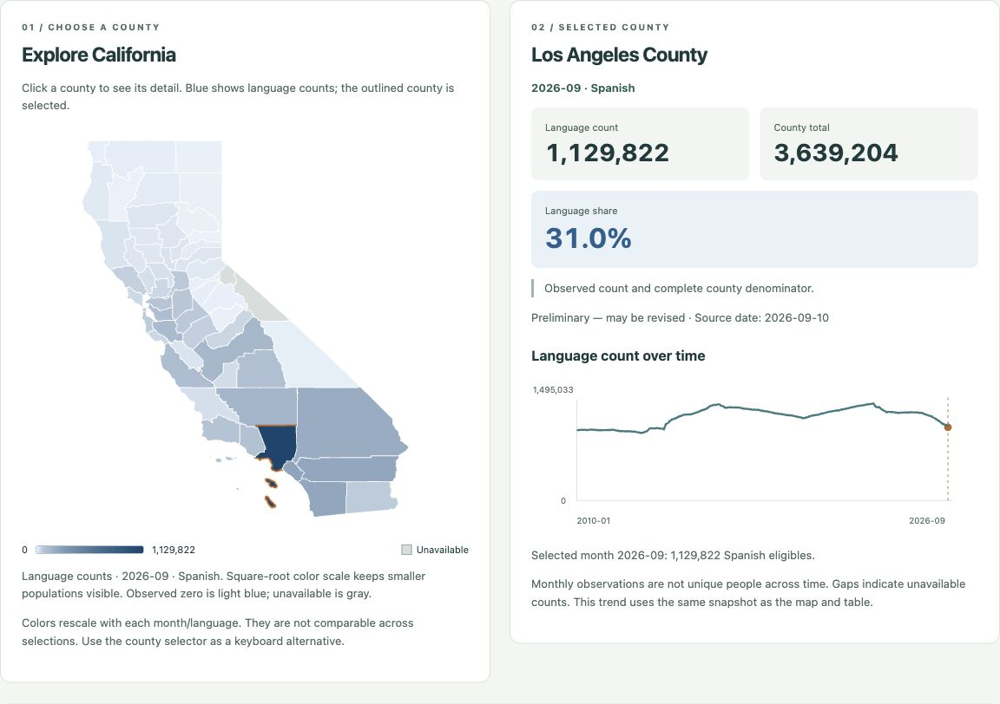
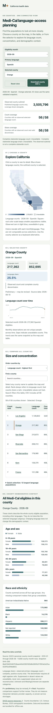

# Dashboard browser verification — November 4, 2026

Implementation commit: `d6e8e73b266e9e6e24b8515067771a78677c0bea` on `codex/interactive-county-dashboard`.
Prepared with Codex assistance using the actual local dashboard and browser controls.
This verifies the new implementation and preserves the historical October audit.

## Results

All **22 existing backend tests**, **12 dashboard API tests**, and **22 browser checks** pass.
The independent CSV/Decimal audit also passes 232 snapshot records and seven synthetic cases.
`node --check web/app.js` and `git diff --check` pass. The canonical data and existing backend calculations are unchanged.

## Actual browser checks

- [x] Audited default view
- [x] Map click synchronizes county selector, detail, table, and map
- [x] Table county selection
- [x] Language updates metrics but preserves month/county demographics
- [x] Map keyboard Enter selection
- [x] Table keyboard selection retains keyboard focus
- [x] Unknown preserves all 58 counties with unavailable values
- [x] Suppressed Alpine remains selectable without inferred zero
- [x] Historical month recomputes counts, total and share
- [x] Share sorting puts Imperial first, unavailable last
- [x] Search filters table without silently changing selected county
- [x] Rapid month/language/county changes finish on latest selection
- [x] Warm filter updates measured through browser interaction
- [x] Reset restores defaults, count sorting, and clear search
- [x] 390px mobile layout has no page overflow and linked county selection works
- [x] Observed numerator with incomplete county denominator keeps count but withholds share
- [x] Top-12 bar selection synchronizes county views
- [x] Small positive share is displayed as <0.1% rather than 0.0%
- [x] Map keyboard Space selects a county
- [x] 390px mobile county-map pointer selection
- [x] Skip link moves keyboard focus to county detail
- [x] Actual CSV download during filtered search retains all 58 rows and unavailable blanks

No browser console errors or warnings were observed. Full observations are in
[dashboard_browser_checks.json](dashboard_browser_checks.json). The new independent
backend result is [dashboard_backend_audit.json](dashboard_backend_audit.json).
The original `module09_shawn_shih_audit.json` is byte-for-byte unchanged.

## Confirmed values

| Selection | Count | County total | Share |
| --- | ---: | ---: | ---: |
| September 2026, Spanish, Los Angeles | 1,129,822 | 3,639,204 | 31.0% |
| September 2026, Spanish, Orange | 217,362 | 852,695 | 25.5% |
| September 2026, Mandarin, Los Angeles | 49,336 | 3,639,204 | 1.4% |
| January 2010, Spanish, Los Angeles | 1,083,961 | 2,356,475 | 46.0% |
| May 2022, Spanish, Alpine | 12 | Unavailable | Unavailable |
| September 2026, Mandarin, Fresno | 352 | 484,014 | <0.1% |

September Spanish: observed subtotal **3,505,796**, count/share coverage **56/58**;
complete statewide count/share unavailable. Alpine and Mono remain selectable with
unavailable language counts/shares and no rank. Unknown retains all 58 map/table
counties with no observed subtotal, counts, shares, or ranks.

## Transfer and timing

The default initial data/geometry views total **263,473 bytes before compression** (approximately 263 KB), versus the previous 40,385,605-byte raw-record payload. Equivalent gzip total: **73,727 bytes**, excluding HTTP headers and HTML/JS/CSS. The live gzip HTTP comparison response decoded correctly.

| Endpoint | Uncompressed bytes | Gzip bytes |
| --- | ---: | ---: |
| `/api/metadata` | 4,183 | 1,401 |
| `/api/geometry` | 213,290 | 67,838 |
| `/api/comparison?month=2026-09&language=spanish` | 27,271 | 2,333 |
| `/api/county?month=2026-09&language=spanish&county=Los+Angeles` | 18,729 | 2,155 |

Warm language-filter changes completed in 116 ms, 113 ms, and 21 ms in three local
browser automation samples, below the two-second local target. These are local
interaction samples, not a production/network performance benchmark.

## Repeatable acceptance demo

1. Run `.venv/bin/python dashboard.py`. Confirm September 2026 / Spanish / Los Angeles and the values above.
2. Click Orange on the map. The selector, map outline, table highlight, detail values, demographics, and trend must all refer to Orange.
3. Choose Los Angeles in the table, then Mandarin: 49,336 and 1.4%; same-month county demographics must not change.
4. Choose Unknown: retain all 58 counties and explain that none can be ranked. Return to Spanish and select Alpine: preserve unavailable language values.
5. Choose May 2022 / Spanish / Alpine: count 12 remains observed, while the incomplete denominator and share stay unavailable.
6. Sort by share: Imperial first, unavailable last. Search Alameda and export: CSV must still contain all 58 counties, denominator/share fields, dates/status, and snapshot hash.
7. Use Tab/Enter/Space on map/table choices and the skip link. Repeat at a narrow viewport. Change filters quickly: only the final selection should render.
8. Reset: restore starting filters, count sorting, and empty search.

## Screenshots

Desktop map and synchronized detail:

Mobile workflow (390 pixels wide):

## Scope

Checked locally at 1280×900 and 390×844; not a cross-browser or formal screen-reader
audit. The snapshot contains no observed zero language counts or zero county totals;
synthetic backend tests cover those cases. Real suppression, incomplete denominators,
missing demographic cells, and an all-unavailable language were checked in the browser.
This feature branch has not been merged into main or deployed.

Source/code hashes, payload sizes, and test counts are in
[dashboard_verification.json](dashboard_verification.json).
